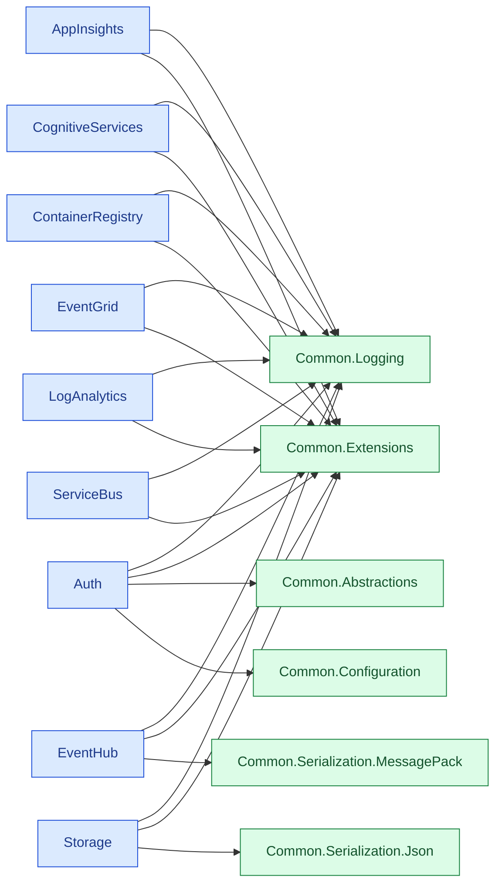

# CasCap.Api.Azure

CasCap.Api.Azure is a collection of .NET libraries for Azure authentication, storage, messaging,
speech, document layout and monitoring. Choose a package for the Azure service your application uses; the libraries
target .NET 10 and .NET 11.

## Packages

Each package's README includes its installation, authentication requirements and current API contract.

| Package documentation | Purpose | NuGet |
| --- | --- | --- |
| [AppInsights](src/CasCap.Api.Azure.AppInsights/README.md) | Bind Application Insights options; does not install telemetry instrumentation | [](https://www.nuget.org/packages/CasCap.Api.Azure.AppInsights) |
| [Auth](src/CasCap.Api.Azure.Auth/README.md) | Certificate and workload-identity credentials; HTTP bearer authentication | [](https://www.nuget.org/packages/CasCap.Api.Azure.Auth) |
| [CognitiveServices](src/CasCap.Api.Azure.CognitiveServices/README.md) | Speech synthesis, recognition, transcription and bounded PDF layout transport | [](https://www.nuget.org/packages/CasCap.Api.Azure.CognitiveServices) |
| [ContainerRegistry](src/CasCap.Api.Azure.ContainerRegistry/README.md) | List registry repositories and manifests to a logger | [](https://www.nuget.org/packages/CasCap.Api.Azure.ContainerRegistry) |
| [EventGrid](src/CasCap.Api.Azure.EventGrid/README.md) | Bounded Blob Storage notification parsing and SDK dependencies | [](https://www.nuget.org/packages/CasCap.Api.Azure.EventGrid) |
| [EventHub](src/CasCap.Api.Azure.EventHub/README.md) | MessagePack publishing and checkpointed diagnostic receiving | [](https://www.nuget.org/packages/CasCap.Api.Azure.EventHub) |
| [LogAnalytics](src/CasCap.Api.Azure.LogAnalytics/README.md) | Fixed workspace and Application Insights exception queries | [](https://www.nuget.org/packages/CasCap.Api.Azure.LogAnalytics) |
| [ServiceBus](src/CasCap.Api.Azure.ServiceBus/README.md) | Queue and topic sending and event-based receiving | [](https://www.nuget.org/packages/CasCap.Api.Azure.ServiceBus) |
| [Storage](src/CasCap.Api.Azure.Storage/README.md) | Blob, Queue and Table Storage base classes | [](https://www.nuget.org/packages/CasCap.Api.Azure.Storage) |

## Dependency Graph

The nine Azure packages are independent of one another. Arrows show their direct shared-library
references; Azure SDK and other third-party dependencies are omitted.



Blue nodes are packages in this repository; green nodes are published `CasCap.Common` dependencies.
All package labels omit the common `CasCap.` prefix; Azure package labels also omit `Api.Azure.`.

## Upgrading to 2.0

The Storage interface adds required create-only upload and metadata-read members. Direct
implementers and test doubles must implement them; subclasses of `AzBlobStorageBase` inherit the
implementations. See the [Storage migration notes](src/CasCap.Api.Azure.Storage/README.md#migrating-to-20)
for the contract. Existing overwrite uploads retain their behavior.

Auth configuration failures now use `CasCap.Common.Exceptions.ConfigurationException`, a subtype of
`GenericException`. Existing base-type catches still work; exact-type assertions should be updated.

## Quick Start

For example, install the Storage package in a consuming application:

```powershell
dotnet add package CasCap.Api.Azure.Storage
```

Derive a concrete service and supply a connection string from the application's secret-backed
configuration. Constructing the blob service contacts storage and creates the container if absent.

```csharp
using CasCap.Services;

public sealed class DocumentStorage(string connectionString)
    : AzBlobStorageBase(connectionString, "documents")
{
}
```

```csharp
using Microsoft.Extensions.Configuration;

var connectionString = configuration.GetConnectionString("Storage")
    ?? throw new InvalidOperationException("Configure the Storage connection string.");
var storage = new DocumentStorage(connectionString);
await storage.UploadBlob("example.txt", "Hello"u8.ToArray(), cancellationToken);
```

See the [Storage README](src/CasCap.Api.Azure.Storage/README.md) for token credentials, service-version
selection and queue deletion semantics.

## Authentication and Service Requirements

Provision the relevant Azure resource and grant the caller the data-plane permissions required for
its operations. SDK-backed services accept `TokenCredential` where documented; other overloads take
connection strings or subscription keys. Keep credentials, private keys and connection strings in
user secrets or a deployment secret provider, not source control.

The [Auth package](src/CasCap.Api.Azure.Auth/README.md) creates certificate or workload-identity
credentials. Authentication does not grant resource access by itself. Check the selected package's
requirements before running examples, which can create resources, send messages or incur charges.

## Development

A stable .NET 11 RC3 SDK can build all target frameworks. From the repository root:

```powershell
dotnet build .\CasCap.Api.Azure.Release.slnx --configuration Release
```

Release configuration consumes published dependencies. Debug configuration additionally requires an
adjacent [CasCap.Common checkout](https://github.com/f2calv/CasCap.Common). When restoring separately,
pass `-p:Configuration=Release`; a Debug restore followed by a Release `--no-restore` build does not
validate the published dependency graph.

The repository has **12 projects: nine packages and three test projects**.
[Auth tests](src/CasCap.Api.Azure.Auth.Tests/README.md) are offline;
[CognitiveServices tests](src/CasCap.Api.Azure.CognitiveServices.Tests/README.md) use synthetic offline
HTTP responses for layout transport;
[Storage tests](src/CasCap.Api.Azure.Storage.Tests/README.md) include Azurite-backed integration tests
that create and change emulator data. Their READMEs document inventories and prerequisites.
Do not point the storage test configuration at a shared Azure account.

## License

Released under the [MIT License](LICENSE).
