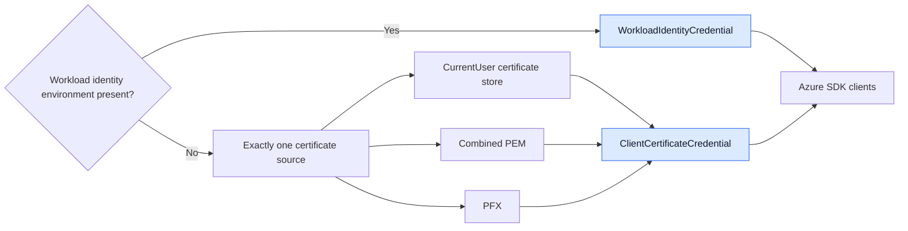

# CasCap.Api.Azure.Auth

Azure credential helpers for .NET applications using client certificates or Kubernetes workload
identity. The package also supplies an HTTP bearer handler and optional certificate-authentication
registration for an Agent Runtime client.

## Installation

Targets `net8.0`, `net9.0` and `net10.0`.

```powershell
dotnet add package CasCap.Api.Azure.Auth
```

## Usage

Bind the application's configuration to `AzureAuthConfig`, then explicitly decide whether to use
Key Vault before resolving a credential:

```csharp
using CasCap.Models;
using Microsoft.Extensions.Configuration;

var auth = configuration.GetSection(AzureAuthConfig.ConfigurationSectionName)
    .Get<AzureAuthConfig>()
    ?? throw new InvalidOperationException("Configure AppConfig.");

if (auth.IsKeyVaultEnabled)
{
    var credential = auth.TokenCredential
        ?? throw new InvalidOperationException("Configure an Azure identity.");
    // Pass credential to an Azure SDK client or a Key Vault configuration provider.
}
```

`AzureAuthConfig` implements
[`IAppConfig`](https://github.com/f2calv/CasCap.Common/blob/main/src/CasCap.Common.Abstractions/Abstractions/_IAppConfig.cs)
and [`IAzureAuthConfig`](https://github.com/f2calv/CasCap.Api.Azure/blob/eaaffef87e366fa62ddc5328dd6f71add9b6397c/src/CasCap.Api.Azure.Auth/Abstractions/IAzureAuthConfig.cs). Its `TokenCredential` property
lazily calls `TokenCredentialExtensions.CreateTokenCredential`. This package does not install a
Key Vault configuration provider or automatically grant access to Azure resources.

## Configuration Examples

Minimal configuration for an application that deliberately does not use Key Vault:

```json
{
  "AppConfig": {
    "KeyVaultName": "skip"
  }
}
```

`"skip"` is case-insensitive and makes `IsKeyVaultEnabled` false. **The caller must check that flag**:
reading `TokenCredential` directly still invokes the factory, even when Key Vault is disabled.
Supply other secrets through user secrets, environment variables or a secret-backed provider.

Certificate authentication uses the same section:

```json
{
  "AppConfig": {
    "KeyVaultName": "your-vault-name",
    "AzureEntraTenantId": "00000000-0000-0000-0000-000000000000",
    "AzureEntraApplicationId": "00000000-0000-0000-0000-000000000000",
    "AzureEntraPemPath": "C:\\credentials\\client.pem"
  }
}
```

Replace placeholders through private configuration. Configure **exactly one** certificate source:

| Property | Source |
| --- | --- |
| `AzureEntraCertThumbprint` | Current user's Personal certificate store (`CurrentUser\My`) |
| `AzureEntraPemPath` | One combined PEM file containing the certificate and private key |
| `AzureEntraPfxPath` | PKCS#12/PFX file; optional password in `AzureEntraPfxPassword` |

Multiple sources cause an exception rather than fallback selection. A missing matching certificate
or no configured source returns `null`; a loaded certificate without tenant/application IDs throws.
Upload the corresponding public certificate to the Entra application and grant that identity the
required resource permissions. Protect private keys, passwords, cache/state and local paths; never
commit them.

For workstation use, install the certificate with its private key in the current user's store and
keep the thumbprint in the consuming application's user secrets. Remove deployment-only PEM/PFX
settings from local providers so they do not conflict with the thumbprint.

### Workload Identity

The factory selects `WorkloadIdentityCredential` when **all four** environment variables are present:
`AZURE_CLIENT_ID`, `AZURE_TENANT_ID`, `AZURE_FEDERATED_TOKEN_FILE` and `AZURE_AUTHORITY_HOST`.
It checks presence, not whether the values are valid.

Workload identity takes priority over certificate settings. `AzureEntraPodManagedIdentityClientId`
optionally overrides the injected client ID. The cluster's identity federation and resource
permissions must already be configured; this package does not provision them.

### HTTP Client Authentication

`TokenCredentialBearerHandler` requests tokens for its supplied scopes and preserves an existing
caller-owned Authorization header. `AddAgentRuntimeAzureAuthentication(configuration)` binds
`CasCap:AgentRuntimeAzureAuthConfig` on an `IHttpClientBuilder` and adds the handler only when enabled:

```csharp
using Microsoft.Extensions.Configuration;
using Microsoft.Extensions.DependencyInjection;

services.AddSingleton<IConfiguration>(configuration);
services.AddHttpClient("runtime")
    .AddAgentRuntimeAzureAuthentication(configuration);
```

Use the same registered `IConfiguration` for options binding. The extension reads its argument once
to decide whether to add the handler; changing `Enabled` later does not rebuild that registration.

The minimal configuration leaves authentication disabled:

```json
{
  "CasCap": {
    "AgentRuntimeAzureAuthConfig": {
      "Enabled": false
    }
  }
}
```

An enabled configuration requires a separate identity and API scope:

```json
{
  "CasCap": {
    "AgentRuntimeAzureAuthConfig": {
      "Enabled": true,
      "TenantId": "00000000-0000-0000-0000-000000000000",
      "ClientId": "00000000-0000-0000-0000-000000000000",
      "Certificate": "your-combined-pem-certificate-and-private-key",
      "Scope": "api://00000000-0000-0000-0000-000000000000/.default"
    }
  }
}
```

`Certificate` is **PEM content**, not a file path. Supply real content from a secret provider.
`GetTokenCredential()` creates the certificate credential lazily; validation requires the identity,
certificate and scope when enabled. These options are separate from `AppConfig`.

## Data Flow

Certificate sources are alternatives, while detected workload identity takes priority:



The same selection is described above for readers whose registry does not render Mermaid.

## Documentation

- [Credential factory](https://github.com/f2calv/CasCap.Api.Azure/blob/main/src/CasCap.Api.Azure.Auth/Extensions/TokenCredentialExtensions.cs)
- [HTTP client registration](https://github.com/f2calv/CasCap.Api.Azure/blob/main/src/CasCap.Api.Azure.Auth/Extensions/AgentRuntimeAzureAuthHttpClientBuilderExtensions.cs)
- [Offline authentication tests](https://github.com/f2calv/CasCap.Api.Azure/blob/main/src/CasCap.Api.Azure.Auth.Tests/README.md)
- [Package catalogue and license](https://github.com/f2calv/CasCap.Api.Azure#packages)
